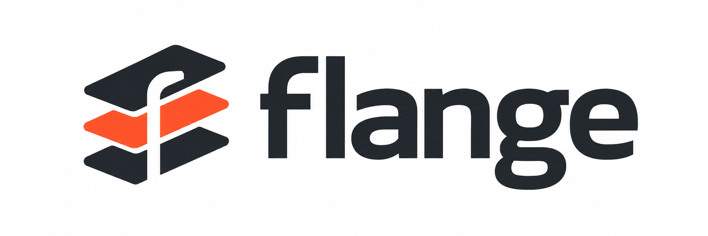
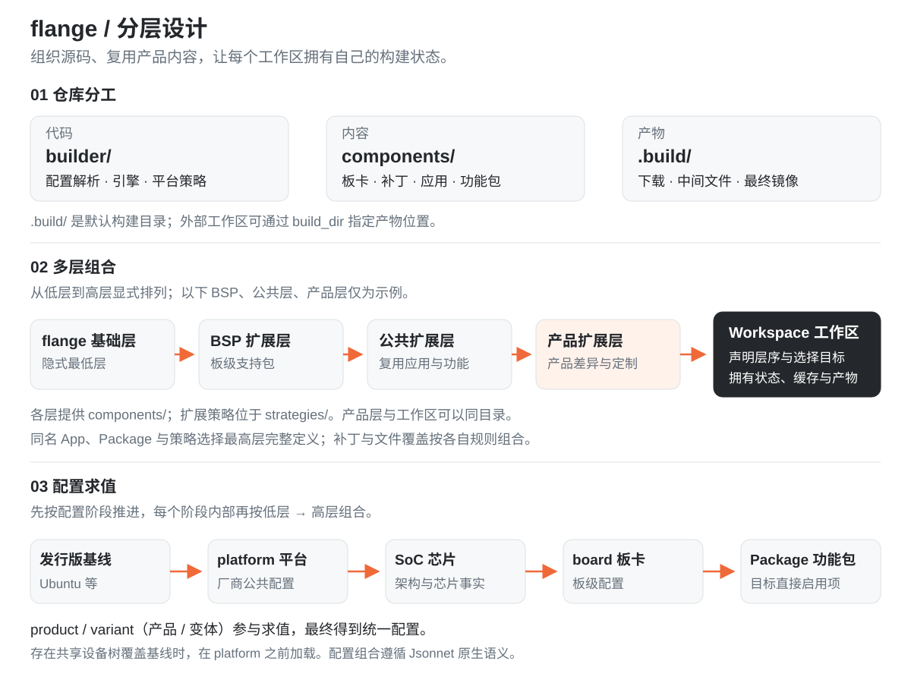
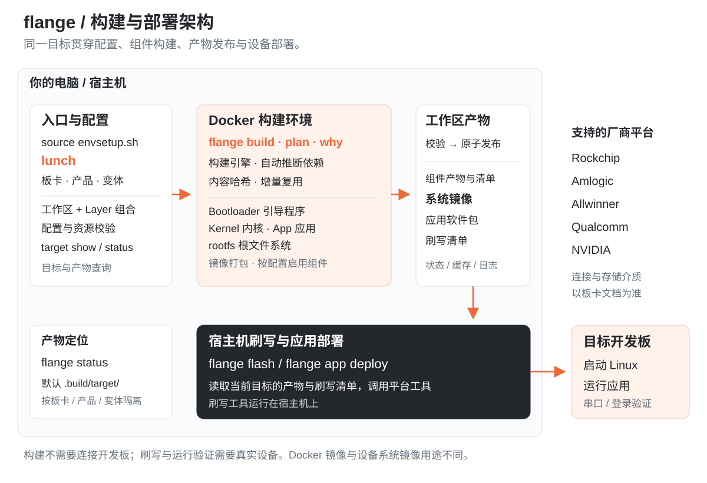

<p align="center">
  
</p>

<h1 align="center">从源码，到开发板上的 Linux。</h1>
<p align="center">构建系统镜像 · 增量更新组件 · 开发板端应用</p>
<p align="center">
  <a href="https://github.com/flange-build/flange/blob/main/LICENSE"></a>
  
  <a href="#快速开始">快速开始</a> ·
  <a href="#支持的开发板">支持的开发板</a> ·
  <a href="docs/README.md">文档</a> ·
  <a href="CONTRIBUTING.md">参与贡献</a>
</p>

**flange 是基于 ubuntu-base（Ubuntu 最小基础文件系统）的嵌入式 Linux 构建框架。**
选择开发板、产品与调试/发布变体，在 Docker 中编译和打包，再由宿主机把镜像刷入设备。
既能交付完整系统，也能独立更新组件，或在仓库外开发板上运行的 App（应用）。

- **同一套命令贯穿开发**：`lunch` 选目标，`flange build` 构建，`flange flash` 刷写。
- **按内容增量构建**：自动推断组件依赖，通过输入指纹与产物校验复用缓存；`flange why` 解释重建原因。
- **系统与应用分工明确**：Bootloader（引导程序）、Kernel（内核）、rootfs（根文件系统）分别构建；App 支持独立构建、部署与调试。
- **按层组合产品**：用 Jsonnet 定义板卡与产品，通过 Layer（扩展层）接入私有内容、其他发行版和打包后端。

## 快速开始

需要 **Linux 或 macOS、Git 与 Git LFS、Python 3.12+（含 venv/pip）、Bash 或 Zsh、Docker 与 Compose v2**。
内核源码与工作树必须位于大小写敏感文件系统；首次安装 Jsonnet 若没有匹配的预编译包，需要宿主 C++ 编译工具。
部分源码使用 Git SSH 地址，需要相应访问凭据；环境安装、源码检查及 macOS 注意事项见[第一次使用](docs/first-steps.md)。

```bash
git lfs install
git clone https://github.com/flange-build/flange.git
cd flange
git lfs pull
source envsetup.sh

# 选择自己的板卡、产品和变体
lunch

# 首次准备构建容器，然后生成系统镜像
flange docker build
flange build

# 查看产物；按板卡说明连接设备并进入下载模式后刷写
flange status
flange flash
```

也可以直接选目标，例如 `lunch radxa-zero3w-default-debug`。
构建不需要连接设备；刷写在宿主机执行，会覆盖目标分区，请先备份并阅读[对应板卡说明](docs/boards/README.md)。
各平台的下载模式、宿主支持和分区约束见[启动、镜像与刷写](docs/boot-and-flash.md)。

**还没有开发板？** 选定目标并准备 Docker 镜像后，运行 `flange plan image`，可查看构建计划而不编译或写设备。
计划成功表示配置与依赖可以解析；镜像生成、设备启动及外设验收需要分别验证。

常用的组件迭代命令：

```bash
flange build kernel       # 增量构建内核
flange why kernel         # 查看影响重建的输入
flange target list        # 查看可选目标
flange --help             # 查看全部命令
```

完整操作、产物路径、日志和失败处理见[开发指南](docs/development-guide.md)。

## 支持的开发板

仓库内置 **27 个板卡配置，覆盖 5 个芯片厂商家族**（核对于 2026-11-11）。
配置数量包含鲁班猫的硬件版本；配置存在不等于全部外设已验收。
每块板的产品、介质、接线、刷写和实际验证范围集中在[板卡索引](docs/boards/README.md)。

| 厂商家族 | 配置数 | 代表板卡与芯片 |
| --- | ---: | --- |
| Rockchip | 17 | [RK3506B](docs/boards/atk-rk3506b.md)、[Luckfox RV1106](docs/boards/luckfox-pico-pro-max.md)、RK3566/3568/3576、[ROCK 5B / RK3588](docs/boards/radxa-rock5b.md)、RK3582/3588S |
| Amlogic | 3 | [VIM3 / A311D](docs/boards/khadas-vim3.md)、[VIM3L / S905D3](docs/boards/khadas-vim3l.md)、[ZERO / S905Y2](docs/boards/radxa-zero.md) |
| Allwinner | 2 | [Cubie A7A](docs/boards/radxa-cubie-a7a.md)、[Cubie A7Z](docs/boards/radxa-cubie-a7z.md)，A733 |
| Qualcomm | 4 | [Dragon Q6A](docs/boards/radxa-dragon-q6a.md)、[RUBIK Pi 3](docs/boards/thundercomm-rubikpi3.md)、[Dragon Q8B](docs/boards/radxa-dragon-q8b.md)、[Arduino UNO Q](docs/boards/arduino-uno-q.md) |
| NVIDIA | 1 | [Jetson TX2 / Tegra186](docs/boards/nvidia-jetson-tx2.md)，L4T R32.7.6，刷写要求 x86_64 Linux |

## 架构与扩展

仓库分为 **代码 `builder/`、内容 `components/`、产物 `.build/`** 三层。
工作区显式组合扩展层；配置按发行版、平台、SoC（片上系统）、板卡和功能包逐阶段求值。

[](docs/assets/architecture/flange-layers.svg)

宿主负责目标解析和设备操作，Docker 负责组件编译与镜像制作，校验后的产物发布到工作区。
**Docker 镜像**是构建环境，**系统镜像**才是刷入设备的产物。

[](docs/assets/architecture/flange-architecture.svg)

[架构参考](docs/build-system-design.md) · [配置参考](docs/configuration.md) · [多层工作区](docs/layers.md)

## 文档入口

| 你想做什么 | 从这里开始 |
| --- | --- |
| 第一次使用，跑通构建与设备流程 | [入门教程](docs/first-steps.md) → [开发指南](docs/development-guide.md) |
| 开发板上应用、拆分运行包与开发包 | [App 参考](docs/app-architecture.md) → [包格式后端](docs/package-backends.md) |
| 适配板卡、平台或硬件功能 | [扩展指南](docs/extension-guide.md) → [板卡索引](docs/boards/README.md) → [硬件专题](docs/hardware/displays.md) |
| 排查缓存、构建、刷写或设备问题 | [维护指南](docs/maintenance-guide.md) → [当前能力边界](docs/limitations.md) |
| 使用 Recovery 或 AMP | [Recovery 维护系统](docs/recovery.md) · [AMP 非对称多处理](docs/amp.md) |

全部指南、组件、协议和外设参考见[文档导航](docs/README.md)。

## 参与贡献与许可

提交改进请阅读[贡献指南](CONTRIBUTING.md)；开发与 Agent 规则统一维护在 [AGENTS.md](AGENTS.md)。
反馈问题请向 [GitHub Issues](https://github.com/flange-build/flange/issues) 提供完整目标名、宿主环境、复现命令和脱敏日志。

flange 自有代码与文档采用 [Apache License 2.0](LICENSE)。
第三方源码、固件、工具及镜像内软件包保留各自许可，详见[许可说明](docs/licensing.md)。
